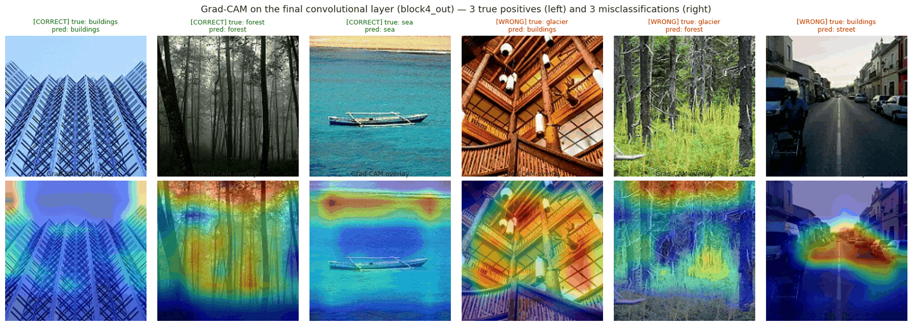
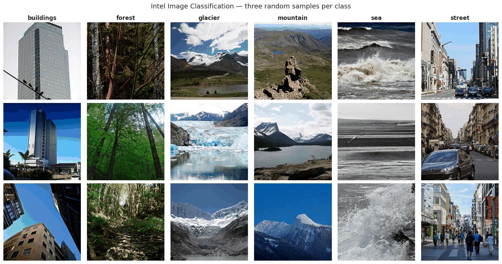
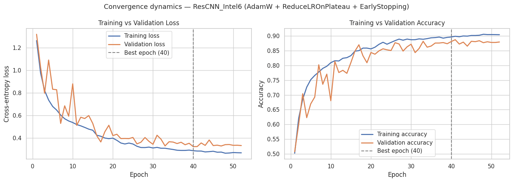
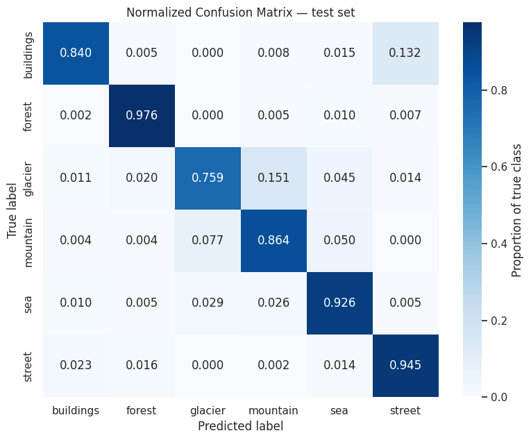

# Natural-Scene Classification with a Residual CNN + Grad-CAM

A custom **residual convolutional neural network**, built from scratch in TensorFlow/Keras, that classifies natural-scene photos into 6 classes, with **Grad-CAM** heatmaps showing *where* the model looks when it makes a decision.

**Test accuracy: 88.4%** on 2,556 held-out images (macro F1: 0.884)



---

## Problem

Scene classes often overlap: glaciers sit on mountains, and street photos are full of buildings. The goal was to build a CNN **from scratch (no pre-trained model)** that can still tell them apart, and then use explainability tools to check *why* it decides what it decides.

## Dataset

[Intel Image Classification](https://www.kaggle.com/datasets/puneet6060/intel-image-classification) (Kaggle): 17,034 labelled RGB images, 150×150, 6 classes:
`buildings` · `forest` · `glacier` · `mountain` · `sea` · `street`



## Approach

| Step | What I did | Why |
|---|---|---|
| **Data split** | Stratified 70 / 15 / 15 (train / val / test), with checks proving zero overlap | Keeps class balance equal in every split and prevents data leakage |
| **Input pipeline** | `tf.data` with parallel decoding, caching and prefetching | Keeps the GPU busy instead of waiting for images to load |
| **Augmentation** | Random flip, rotation, translation, zoom (training set only) | Helps the model learn shapes, not memorise pixel positions |
| **Model** | Custom residual CNN (Keras Functional API): stem + 4 residual blocks, BatchNorm, SpatialDropout, Global Average Pooling, ~4.95M parameters | Skip connections stop gradients from vanishing in deeper networks |
| **Training** | AdamW (lr 1e-3, weight decay 1e-4), EarlyStopping, ReduceLROnPlateau, ModelCheckpoint | Stops at the best epoch and lowers the learning rate when progress stalls |
| **Evaluation** | Classification report, normalized confusion matrix, error analysis | Shows which classes are hard and why |
| **Explainability** | Grad-CAM on the last convolutional layer | Shows which image regions drove each prediction |

## Results

| Metric | Value |
|---|---|
| Test accuracy | **88.38%** |
| Macro F1-score | 0.884 |
| Best epoch | 40 (early-stopped at 52) |
| Validation → test gap | +0.24 pts (good generalization) |

| Class | Precision | Recall | F1 |
|---|---|---|---|
| buildings | 0.94 | 0.84 | 0.89 |
| forest | 0.95 | 0.98 | 0.96 |
| glacier | 0.88 | 0.76 | 0.81 |
| mountain | 0.82 | 0.86 | 0.84 |
| sea | 0.87 | 0.93 | 0.90 |
| street | 0.87 | 0.94 | 0.90 |

<p align="center">
  
</p>
<p align="center">
  
</p>

## Key findings

- **Most confused pairs:** glacier ↔ mountain (shared snow, ridgelines and sky) and buildings ↔ street (street photos contain buildings; the road is only a small part of the image).
- **Grad-CAM shows the model focuses on the right things:** building façades, forest canopy, the water band in sea images (it ignores the boat).
- **Some "errors" are actually label mistakes in the dataset:** two images labelled *glacier* are really a wooden interior and a forest, and the model predicted what is actually in them. This is a useful reminder that real datasets contain label noise.

## Tech stack

Python · TensorFlow / Keras · NumPy · pandas · scikit-learn · Matplotlib · Seaborn · Google Colab (T4 GPU)

## How to run

1. Open `intel_scene_classification.ipynb` in [Google Colab](https://colab.research.google.com/).
2. **Runtime → Change runtime type → T4 GPU**.
3. **Run all.** The dataset downloads automatically through `kagglehub` (no API key needed). Training takes about 30–60 minutes.

To run locally instead: `pip install -r requirements.txt`, then open the notebook in Jupyter.

## Repository structure

```
├── intel_scene_classification.ipynb   # full notebook with outputs
├── images/                            # figures used in this README
├── requirements.txt
└── README.md
```

---

*Built as part of the Deep Learning module (BSc Computer Science, Taylor's University).*
**Author:** Mohammad Aqel · [GitHub](https://github.com/mohammad-aqel-ai)
